<p align="center">
  
</p>

<h1 align="center">BaroKey</h1>

<p align="center">
  Bộ gõ tiếng Việt cho Linux — Telex &amp; VNI, chạy như một <b>IBus engine</b>,<br>
  dùng được trên GNOME, KDE, X11 và Wayland.
</p>

<p align="center">
  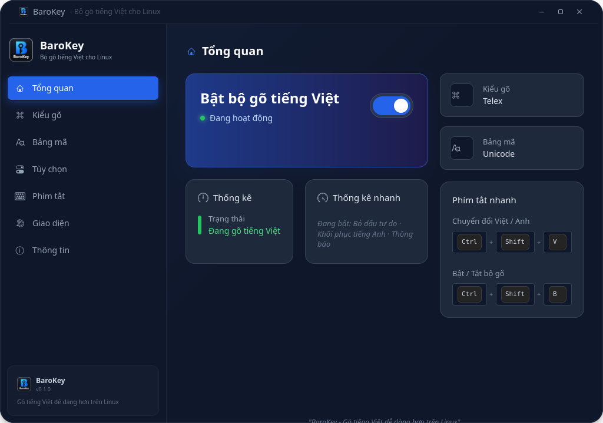
</p>

BaroKey lấy cảm hứng từ EVKey. Lõi chuyển đổi dùng
[bamboo-core](https://github.com/BambooEngine/bamboo-core) (MIT) qua thư viện Rust
`libbaro_bamboo.so`; nếu máy chưa có thư viện này, BaroKey tự dùng lõi Python dự phòng.

## Mục lục

- [Tính năng](#tính-năng)
- [Cài đặt](#cài-đặt)
- [Sử dụng](#sử-dụng)
- [Cửa sổ cấu hình](#cửa-sổ-cấu-hình)
- [Gỡ cài đặt](#gỡ-cài-đặt)
- [Phát triển](#phát-triển)
- [Giới hạn hiện tại](#giới-hạn-hiện-tại)

## Tính năng

**Gõ tiếng Việt**

- Telex: `aa ăw ee oo ow uw dd`, dấu `s f r x j`, xoá dấu `z`, `[` = ơ, `]` = ư
- `w` biến đổi nguyên âm như Ngó Sen: `anw` → `ăn`, `comw` → `cơm`, `chuaw` → `chưa`
- VNI: dấu `1 2 3 4 5`, `6 7 8 9`, xoá dấu `0`
- Đặt dấu thanh kiểu **mới** (hoà, thuỷ) hoặc kiểu **cũ** (hòa, thủy)
- Bỏ dấu tự do: gõ dấu ở bất kỳ vị trí nào trong từ
- Gõ lặp phím để lấy chữ gốc: `barr` → `bar`, `aww` → `aw`, `ww` → `w`
- Tự khôi phục từ không hợp lệ về đúng phím đã gõ: `asd` → `asd`, `stress` → `stress`
- Giữ nguyên chữ hoa/thường: `chEe` → `chÊ`, `CHAOf` → `CHÀO`
- Backspace xoá từng phím rồi chuyển đổi lại: `việt` → `việ`

**Giao diện và tiện ích**

- Chuyển Việt/Anh và bật/tắt bộ gõ bằng phím tắt tuỳ chỉnh hoặc menu IBus
- Thông báo khi chuyển chế độ
- Cửa sổ cấu hình GTK4 có 7 trang, theme sáng / tối / tự động theo GNOME

## Cài đặt

### 1. Chuẩn bị

Trên Ubuntu/Debian:

```bash
sudo apt install ibus python3-gi gir1.2-ibus-1.0 gir1.2-gtk-4.0
```

Muốn dùng lõi bamboo-core (khuyến nghị) cần thêm Rust:

```bash
curl --proto '=https' --tlsv1.2 -sSf https://sh.rustup.rs | sh
```

Không có Rust thì vẫn chạy được bằng lõi Python dự phòng.

### 2. Cài BaroKey

```bash
git clone git@github.com:BaroTon/Baro-Key.git
cd Baro-Key
./install.sh
```

Chạy bằng user thường, không dùng `sudo`. Script sẽ:

- build `libbaro_bamboo.so` nếu tìm thấy `cargo`;
- cài engine và cấu hình vào `~/.local/lib/baro`, `~/.config/baro`;
- cài icon và launcher **BaroKey** vào menu ứng dụng;
- hỏi quyền root qua `pkexec` **một lần** để đặt file
  `/usr/share/ibus/component/baro.xml` (IBus 1.5.34 không quét thư mục component của user).

### 3. Bật bộ gõ

1. Trên GNOME, `install.sh` đã tự thêm **BARO** vào danh sách nguồn nhập. Môi trường khác
   thì thêm tay ở **Settings → Keyboard → Input Sources**.
2. Chuyển nguồn nhập bằng `Super + Space`.
3. Mở **BaroKey** từ menu ứng dụng (hoặc chạy `baro-settings`) để chỉnh cấu hình.

### Đang dùng Fcitx5?

Nếu phiên đang dùng Fcitx5 (`GTK_IM_MODULE=fcitx`) thì Fcitx5 đang giữ tên D-Bus
`org.freedesktop.IBus`, nên IBus/BaroKey không chạy song song được. Chuyển sang IBus:

```bash
im-config -n ibus
```

rồi đăng xuất và đăng nhập lại. Muốn quay lại Fcitx5: `im-config -n fcitx5`.

## Sử dụng

| Việc cần làm | Cách làm |
| --- | --- |
| Chuyển nguồn nhập (BARO ↔ bàn phím khác) | `Super + Space` |
| Chuyển chế độ Việt / Anh | `Ctrl + Shift + V` (mặc định, đổi được); `` Ctrl + ` `` luôn dùng được |
| Bật / tắt bộ gõ | `Ctrl + Shift + B` (mặc định, đổi được) |
| Mở cửa sổ cấu hình | Menu ứng dụng → **BaroKey**, hoặc `baro-settings` |

Ví dụ Telex: gõ `Vieejt Nam` → `Việt Nam`. Ví dụ VNI: gõ `Vie6t5 Nam` → `Việt Nam`.

## Cửa sổ cấu hình

Mọi thay đổi được lưu ngay vào `~/.config/baro/settings.json`.

### Tổng quan

Bật/tắt bộ gõ bằng một công tắc lớn, xem trạng thái, kiểu gõ, bảng mã và phím tắt đang dùng.

<p align="center"></p>

### Kiểu gõ

Chọn **Telex** hoặc **VNI**, và chọn kiểu đặt dấu thanh **mới** (hoà, thuỷ) hay **cũ** (hòa, thủy).

<p align="center">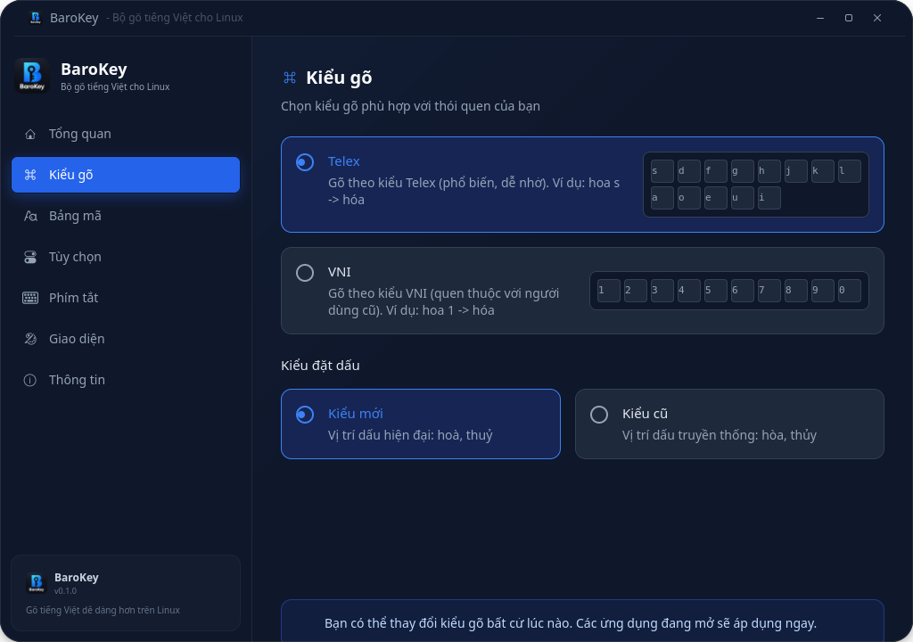</p>

### Bảng mã

Hiện dùng **Unicode**. TCVN3 và VNI Windows hiển thị để tham khảo nhưng chưa hỗ trợ trên Linux.

<p align="center">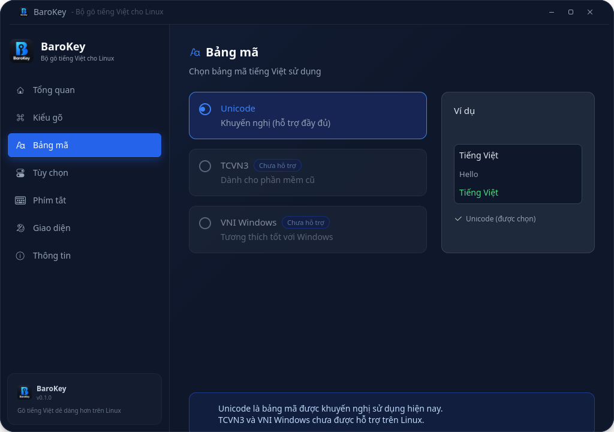</p>

### Tùy chọn

- **Bỏ dấu tự do** — đặt dấu ở vị trí bất kỳ trong từ.
- **Khôi phục phím tiếng Anh** — từ không hợp lệ được trả về đúng phím đã gõ.
- Gõ tắt và sửa lỗi chính tả đang ghi **Chưa hỗ trợ**.

<p align="center">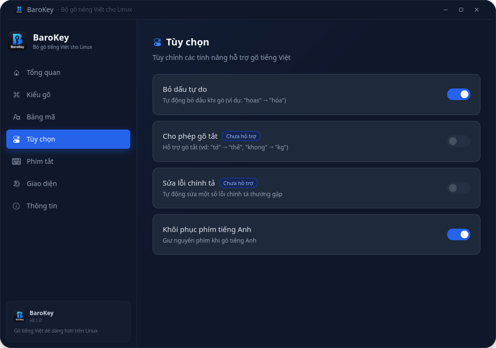</p>

### Phím tắt

Bấm **Thay đổi** để chọn phím chuyển Việt/Anh và phím bật/tắt bộ gõ từ các tổ hợp có sẵn.

<p align="center">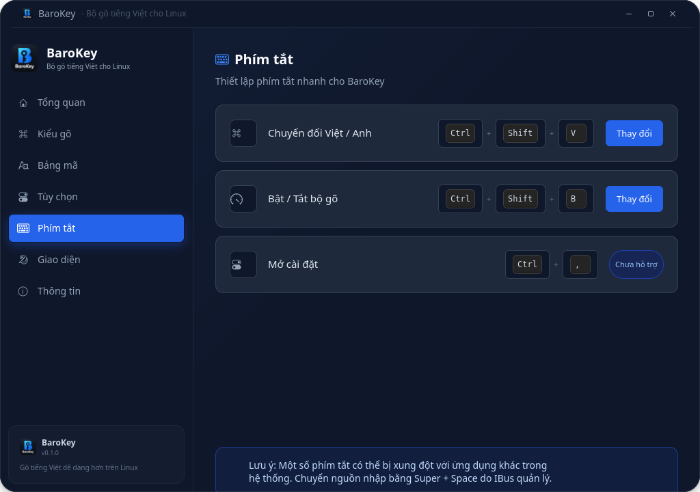</p>

### Giao diện

Chọn **phong cách** (Mặc định hoặc macOS Tahoe), theme **Sáng**, **Tối** hoặc **Tự động**
(theo cài đặt sáng/tối của GNOME), và bật/tắt thông báo khi chuyển chế độ. Mọi thay đổi áp dụng
ngay, không cần mở lại.

<p align="center">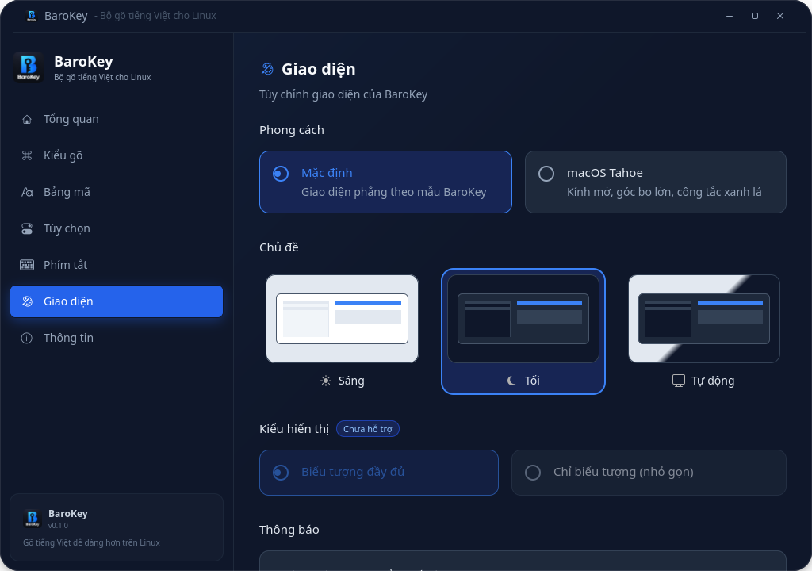</p>

Theme sáng:

<p align="center">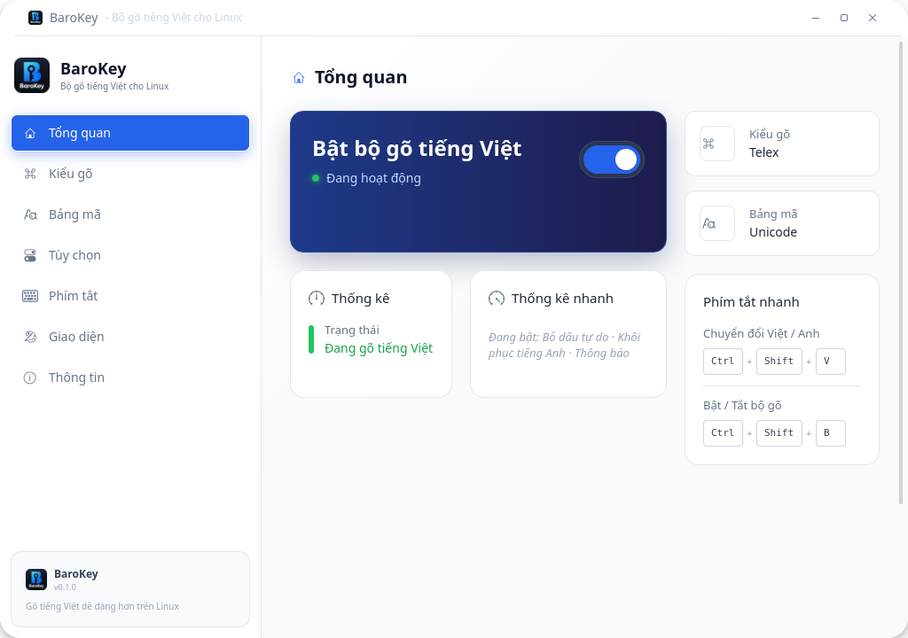</p>

#### Phong cách macOS Tahoe

Phong cách tuỳ chọn lấy cảm hứng từ macOS Tahoe: sidebar nổi bo tròn, card kính mờ, công tắc
xanh lá, ba nút đóng / thu nhỏ / phóng to kiểu đèn giao thông ở góc trái. Có cả theme sáng và tối.
GTK4 không làm mờ được nền phía sau cửa sổ, nên hiệu ứng kính được mô phỏng bằng độ trong
suốt, viền sáng và bóng đổ.

<p align="center">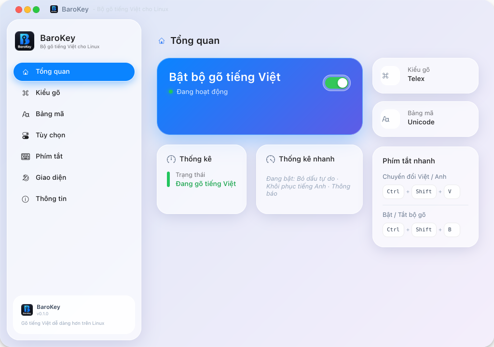</p>
<p align="center">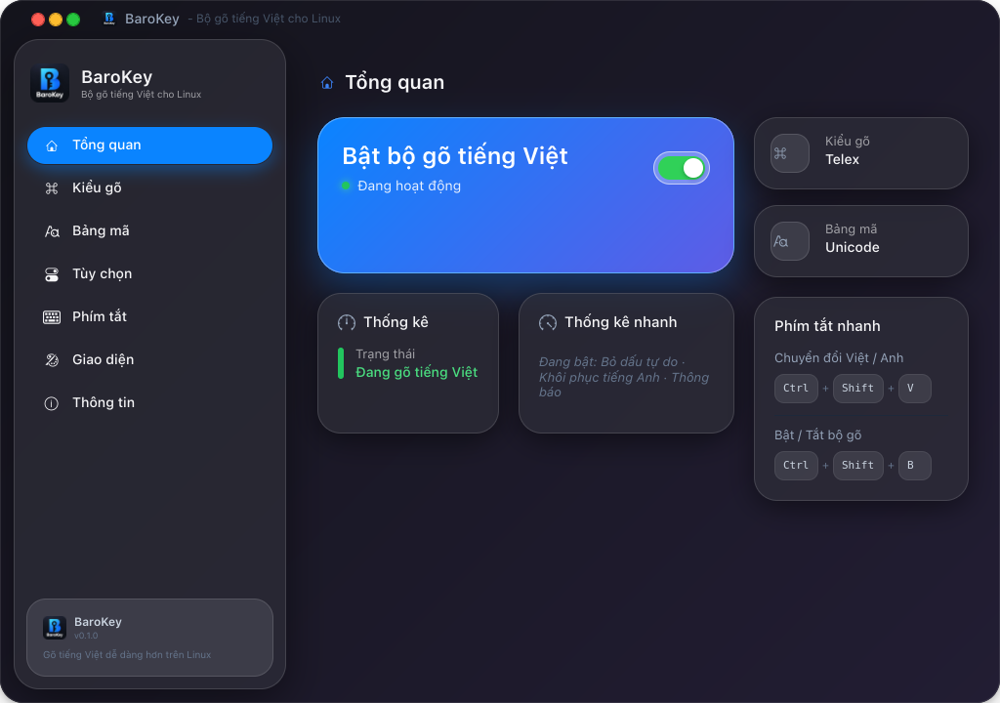</p>
<p align="center">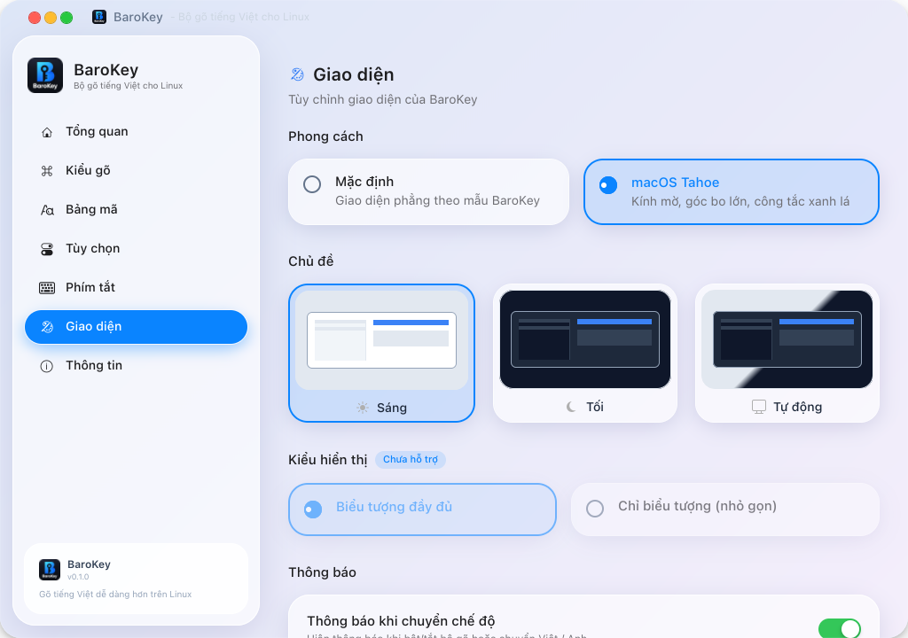</p>

### Thông tin

Phiên bản, liên kết GitHub, báo lỗi và đóng góp cho dự án.

<p align="center">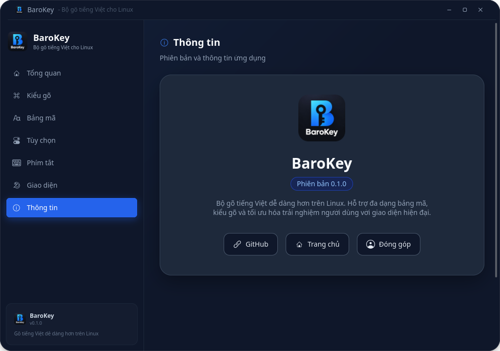</p>

## Gỡ cài đặt

```bash
./uninstall.sh
```

## Phát triển

Chạy test:

```bash
python3 -m unittest discover -s tests -v
```

Chụp lại screenshot trong `docs/screenshots/` (cần phiên đồ hoạ):

```bash
python3 tools/screenshots.py
```

Cấu trúc:

| Đường dẫn | Vai trò |
| --- | --- |
| `baro/bamboo.py` | ctypes binding cho lõi Rust `libbaro_bamboo.so` |
| `baro/core.py` | lõi Telex/VNI dự phòng bằng Python |
| `baro/engine.py` | IBus engine, preedit, phím tắt |
| `baro/config.py` | đọc/ghi `~/.config/baro/settings.json` |
| `baro/notify.py` | thông báo khi chuyển chế độ |
| `fcitx5/rust` | crate dùng `bamboo-core`, build ra thư viện C |
| `bin/baro-settings` | cửa sổ cấu hình GTK4 |
| `desktop/` | icon, logo và file launcher |
| `tools/screenshots.py` | sinh screenshot cho README |
| `tools/make_icons.py` | sinh icon ứng dụng từ `desktop/barokey-source.png` |

## Giới hạn hiện tại

- Chưa có gõ tắt/macro, sửa lỗi chính tả hoặc kiểm tra từ ghép như EVKey. Các mục này hiện
  hiển thị **Chưa hỗ trợ** trong cửa sổ cấu hình.
- Chỉ hỗ trợ bảng mã Unicode; TCVN3 và VNI Windows chưa có.
- Kiểu hiển thị nhỏ gọn và phím tắt "Mở cài đặt" chưa hoạt động.
- Telex và VNI chỉ chọn một kiểu tại một thời điểm, chưa gõ hỗn hợp.
- Từ đang gõ (preedit) hiển thị ngay trong ô nhập. BaroKey đã yêu cầu ứng dụng không gạch chân,
  nhưng ứng dụng nào bỏ qua thuộc tính của IBus (một số app Electron, Chrome, Qt) vẫn có thể tự
  gạch chân.

## Ghi nguồn

Lõi chuyển đổi dùng [bamboo-core](https://github.com/BambooEngine/bamboo-core) (MIT), cùng
engine mà [Ngó Sen](https://github.com/ngosen/ngosen) dùng. Phần IBus, cấu hình và giao diện
của BaroKey là mã của dự án này. Giấy phép: [MIT](LICENSE).
